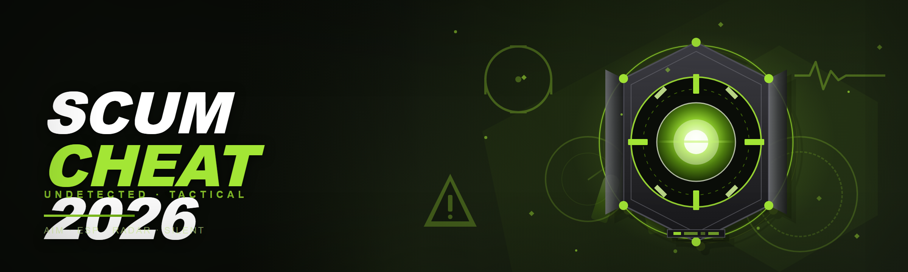
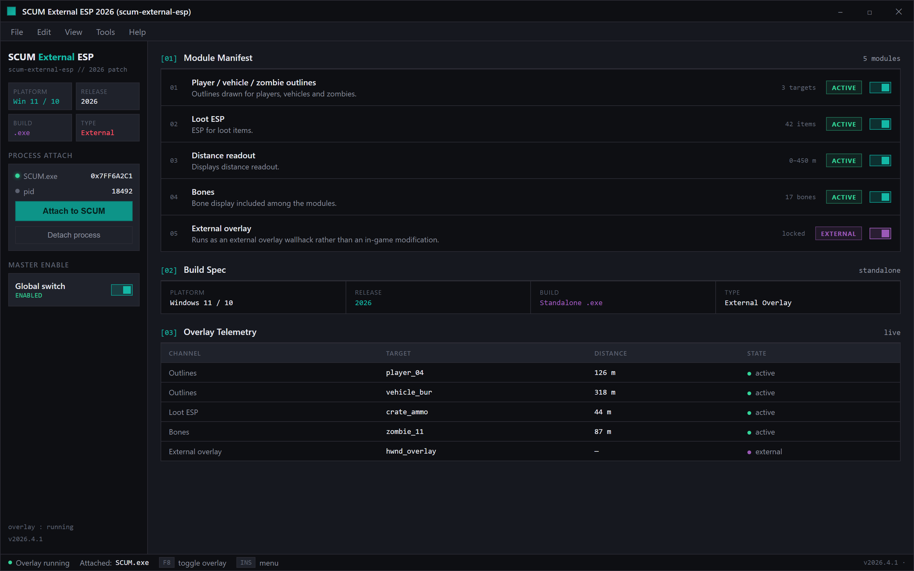
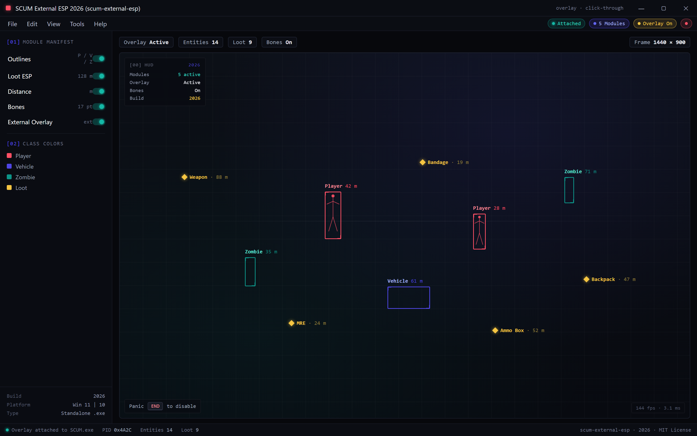

  
  
  

  

  
  

---

SCUM external ESP cheat: player/vehicle/zombie outlines, loot ESP, distance readout, bones — overlay wallhack for 2026 patch.

Module Manifest — 5 modules, all active, external overlay attached.

## Overview

SCUM external ESP cheat: player/vehicle/zombie outlines, loot ESP, distance readout, bones — overlay wallhack for 2026 patch.

External overlay — outlines, loot ESP, distance readout and bones over SCUM.

  

## License

[MIT License](LICENSE)

  

